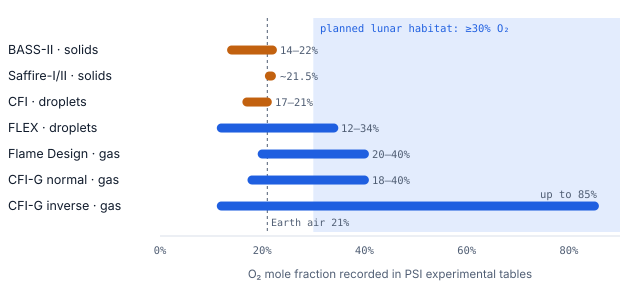

# Flame in Freefall: research brief

**NASA Space Apps 2026 · Team Five-Body Problem · Vienna** · compiled Sat 14 Nov 2026

> **Submission closes Sun 15 Nov, 23:59 Vienna time.**

What the challenge asks for, what the NASA data actually contains, how judging works, and the rules that shape what we can build in 36 hours. The PSI data referred to below is in [`data/`](../data/README.md).

**Contents:** [The ask](#the-ask) · [Rules](#rules-that-shape-the-build) · [Judging](#how-its-judged) · [The data](#what-the-data-actually-is) · [O₂ coverage](#a-fact-from-the-tables-oxygen-coverage) · [Domain facts](#domain-facts-to-have-at-hand) · [Past winners](#what-recent-global-winners-did) · [Team decisions](#decisions-the-team-needs-to-make) · [36-hour plan](#36-hour-plan) · [Sources](#sources)

---

## The ask

Build a **web-based dashboard, powered by SI** (the 2026 term for AI), that **summarizes, ranks and interprets** NASA's microgravity combustion investigations in the Physical Science Informatics (PSI) database, so that the results turn into fire-safety insight for human exploration.

The challenge suggests three things users could do:

1. Find the investigations most relevant to fire safety in crew habitats: spacecraft, stations, lunar and Martian bases, pressurized rovers.
2. Extract data that supports predictive modeling of flammability and fire scenarios.
3. Highlight research that informs next-generation fire-safety controls and equipment.

NASA frames spacecraft fire safety as **prevention** (ignition control, material selection, flammability limits), **detection** (smoke and aerosol sensing) and **suppression** (extinguishing agents, atmosphere dilution). Target users are professors, graduate and undergraduate students, aerospace researchers and engineers. An optional extra is Earth spin-offs such as fine water mist extinguishers, smoke detectors and firefighter gear.

**Out of scope:** rockets and propellants. Their combustion is effectively independent of gravity, and PSI doesn't cover them.

Attributes the brief suggests displaying per investigation: objectives; fuel type, shape and size; O₂ concentration, pressure, airflow; what varied between tests and what was held constant; sensors and measurement types; similarities and differences across investigations.

## Rules that shape the build

> [!IMPORTANT]
> **The idea must be the team's own.** The official Project Submission Guide says: *"SI should not be used to (come up with your idea of how to solve the challenge)."* SI tools are allowed for building it (code, data processing, the product's own SI features). This brief therefore stops at research, data and constraints. The team decides the concept.

- **Disclose SI use.** SI-generated images and video need a visible watermark. SI-generated code, data and audio need an acknowledgement in descriptive text and metadata. Judges see these markers and assess "originality, intent, and execution" of the SI-assisted parts.
- **No NASA branding in generated content.** That covers logos, flags and mission identifiers.
- **Demo:** a video of 30 seconds or less, *or* a deck of up to 7 slides including the title slide. Going over either limit makes the project ineligible for global judging. Host it externally and make the link public with no login.
- **English everywhere.** A video may be spoken in another language if it has English subtitles.
- **Use at least one NASA data source** and list every external resource, including open-source code, text and images. PSI asks for each investigation to be **cited by its DOI**; the DOIs are in `data/investigations/*.json`.
- No images, video or likeness of anyone under 18, and no copyrighted music.
- Only the last click of "Submit for Judging" counts. The project page accepts images only (JPG, PNG or GIF, up to 10 MB).

## How it's judged

At every level, each project is scored 1 to 5 on five criteria. The guide states no weighting, so plan as if they are equal.

| Criterion | What it means | For this challenge |
|---|---|---|
| **Impact** | How significant the problem is and how far the solution reaches | The real incidents (Apollo 1, Apollo 13, the Mir fire, the Artemis II smoke alarm) and the higher-O₂ Moon base give the stakes |
| **Creativity** | Originality, or a meaningful improvement on existing ideas | PSI already has keyword search, so "a search box with a chatbot" is the baseline to beat |
| **Validity** | Scientifically grounded, technically feasible, usable | Every SI claim should trace back to a PSI record, test row or publication. Hallucinated physics will cost points with expert judges |
| **Relevance** | Addresses the chosen challenge, with NASA data as a core part | PSI data must drive the product itself |
| **Presentation** | Clear storytelling; judges look at the demo and the full project | 30 seconds is very short, so script it early |

**Path to a win:** Local judges pick Global Nominees (announced 3 Dec; historically about 10% of projects, 1–3 per event). Global judges pick ~40–45 Finalists (17 Dec). NASA executive judges announce winners on 26 Jan 2027. Ask the Local Lead how many projects Vienna can nominate.

There are ten global awards, including Best Use of Science, Best Use of Data, Best Use of Technology, Galactic Impact, Best Mission Concept, Most Inspirational, Best Storytelling, Art & Technology, Global Connection and Local Impact. For this challenge, **Best Use of Science** and **Best Use of Data** fit most naturally.

## What the data actually is

PSI holds **24 combustion investigations**: 19 flight experiments (ISS, plus Saffire on Cygnus) and 5 ground studies that reanalyse flight data. That is small enough for the team to know every record by heart, which few competing teams will bother to do.

### Three layers, with very different sizes

1. **Investigation metadata** for all 24: title, objectives, hypothesis, approach, keywords, hardware, Earth benefits, PIs, DOI, plus **352 linked publications**. This is clean text and works well for SI summaries and search.
2. **Experimental tables**: one CSV per investigation listing the test conditions. There are 22 files and about **2,000 test rows**, covering fuel, O₂ fraction, pressure, flow speed, diameters, burn time, extinction and similar. *Every file uses a different schema, with different column names, units ("mmHg", "atm", "bar", "%", fraction) and free text such as "~21.5" or "0.17; 0.21; 0.25".* Getting these into one comparable table is the hard and valuable part.
3. **Raw data, about 8 TB**, mostly camera video (.ts/.mp4) and zipped sensor logs. Use only a few representative images or clips as visuals. Don't plan a pipeline on it.

### Unauthenticated JSON API

The PSI website runs on an open JSON API, and no key is needed. Layers 1 and 2 are already in [`data/`](../data/README.md), whose README lists the endpoints:

- `/geode-py/ws/repo/search?term=&source=psi&type=investigation&size=500`
- `/geode-py/ws/repo/investigations/PSI-25` (full record and file list)
- `/geode-py/ws/studies/PSI-69/download?file=<name>&redirect=false` (returns a presigned S3 URL)

### The 24 investigations

The "Role" column follows how the challenge text itself groups them. "Mentioned" means the challenge statement names the investigation explicitly.

| PSI | Acronym | What burns | Hardware | Role | Test rows | Key conditions in table |
|---|---|---|---|---|--:|---|
| PSI-26 | BASS | Solids (fabrics, plastics) + gas | MSG / SPICE duct | prevention · mentioned | 122 | sample material |
| PSI-25 | BASS-II | Solids (PMMA etc.) | MSG / SPICE duct | prevention · mentioned | 129 | material, fan/flow, O₂ 14–22%, CO₂, CO |
| PSI-98 | Saffire-I | Large SIBAL fabric | Cygnus, after ISS departure | prevention · mentioned | 4 | size, airflow, O₂, burn time, flow direction |
| PSI-99 | Saffire-II | 9 materials incl. silicone, Nomex | Cygnus | prevention · mentioned | 15 | µg vs 1g burn length / spread |
| PSI-100 | Saffire-III | Large SIBAL fabric | Cygnus | prevention · mentioned | 2 | size, airflow |
| PSI-20 | ACME BRE | Gas emulating solids | CIR / ACME | prevention · mentioned | 18 | burner size, O₂ 21–40% |
| PSI-102 | SAME | Smoke from spacecraft materials | MSG | detection · mentioned | 8 | material, airflow, aging |
| PSI-101 | SAME-R | Smoke (Kapton, Teflon…) | MSG | detection · mentioned | 109 | inlet velocity, aging/mixing time |
| PSI-47 | DAFT / DAFT-2 | Dust (same instrument as SAME) | ISS cabin | detection · mentioned | 2 | sample, location |
| PSI-69 | FLEX | Fuel droplets | CIR / MDCA | suppression · mentioned | 274 | fuel, pressure, O₂/N₂/CO₂/He, diameter, burn rate, extinction |
| PSI-68 | FLEX-2 | Fuel droplets, mixtures | CIR / MDCA | suppression · mentioned | 8 | condition ranges (summary) |
| PSI-39 | CFI | Droplets, cool flames | CIR / MDCA | mentioned | 87 | pressure 0.5–5 atm, O₂, He, fuel |
| PSI-159 | ACME CFI-G | Gaseous, cool flames | CIR / ACME | highest O₂ · mentioned | 333 | O₂ up to 85%, pressure, Tad, extinction |
| PSI-22 | ACME E-FIELD | Gaseous | CIR / ACME | partial-g proxy · mentioned | 32 | mesh polarity, fuel |
| PSI-10 | ACME Flame Design | Gaseous, soot | CIR / ACME | ACME | 327 | O₂, flow, pressure, Zst, Tad |
| PSI-21 | ACME CLD Flame | Gaseous coflow | CIR / ACME | ACME | 32 | fuel concentration |
| PSI-23 | ACME s-Flame | Gaseous | CIR / ACME | ACME | 18 | atmosphere, fuel |
| PSI-107 | SPICE | Gaseous jets, soot | MSG / SPICE duct | mentioned | 469 | fuel, nozzle, fuel and air rate |
| PSI-106 | SLICE | Gaseous jets, liftoff | MSG / SPICE duct | mentioned | 12 | fuel |
| PSI-60 | (ground) | SPICE reanalysis: soot | — | ground | — | |
| PSI-62 | (ground) | BASS flame-spread modeling | — | ground | — | |
| PSI-115 | (ground) | SAME data for detector models | — | ground | — | |
| PSI-117 | (ground) | FLEX cool-flame CFD | — | ground | — | |
| PSI-142 | (ground) | Cool-flame transitions | — | ground | 8 | data summary links |

Test-row counts are non-empty CSV rows; some rows are summaries rather than single tests (FLEX-2 for example). Hardware families come from the challenge text: ACME's six experiments share one modular rig in the Combustion Integrated Rack (CIR). FLEX, FLEX-2 and CFI used the droplet apparatus (MDCA). BASS, BASS-II, SPICE and SLICE shared the fan-driven SPICE flow duct in the Microgravity Science Glovebox (MSG).

## A fact from the tables: oxygen coverage

The challenge states that a Moon base will likely run at **30% O₂ or more, at 10.2 psi (0.69 atm) or less**, which makes materials much more flammable. We plotted the O₂ ranges recorded in the experimental tables against that band.

*Computed from the PSI experimental-table CSVs on 14 Nov. Amber marks solid or droplet tests near air; blue marks investigations reaching ≥30%. Parsing was quick and rough, with mixed units and free-text cells, so verify the numbers before quoting them. Saffire-III has no O₂ column. ACME BRE reports 21 / 26.5 / 40% as text.*

What the tables show:

- The **solid-material** tests that bear most directly on habitat materials (BASS, BASS-II, Saffire) sit at or just below **21% O₂**. BASS-II reaches only 14–22%.
- Data at **≥30% O₂** comes almost entirely from **gas flames** (ACME Flame Design and CFI-G: roughly 360 test rows), plus 24 FLEX droplet tests up to 34%. ACME BRE is the one bridge, because its gas burner emulates burning solids, and it ran at up to 40%.
- PSI holds **no partial-gravity data** yet. LUCI and FM2 should add some later. E-FIELD imitates partial gravity, and 0g and 1g results bound intermediate gravity.

This is a statement about what the data covers. What the team does with it is up to the team.

## Domain facts to have at hand

- **Why microgravity flames differ:** with no buoyancy, hot gas doesn't rise and fresh oxygen doesn't flow in. A candle flame becomes a dim blue sphere fed by diffusion alone. Slow forced airflow, such as ventilation, therefore matters a great deal. It can sustain flames that would die in still air.
- **Atmospheres:** Earth sea level is 14.7 psi at 21% O₂. Spacesuits run 4.3 psi at 100% O₂. A Moon base or pressurized rover will likely run ≥30% O₂ at ≤10.2 psi, which is more than 40% above Earth's O₂ concentration.
- **Suppression agents:** FLEX diluted the chamber with CO₂ and He. The ISS fine-water-mist extinguisher became an Earth spin-off.
- **Detection:** SAME and SAME-R measured smoke particle sizes from burning spacecraft materials to improve smoke detectors. DAFT reused one of the instruments for dust, which matters on the Moon.
- **Historical incidents to cite:** the Apollo 1 cabin fire (1967, 100% O₂ ground test), the Apollo 13 O₂ tank explosion (1970), the Mir O₂-generator fire (1997), and the Artemis II smoke alarm (2026, "about 80,000 miles from home").

## What recent global winners did

- **SpaceGenes+ (2025, Best Use of Science):** a dashboard for the "Space Biology Knowledge Engine" challenge, the closest analogue to ours. It went deep on one real NASA dataset, used a computed score and named specific findings. The team disclosed its AI use.
- **SkySense (2025, Best Use of Technology):** a grounded chatbot over NASA POWER data that turned raw data into clear probabilities, with a fast, stable deployment.
- **Resonant Exoplanets (2025, Best Use of Data):** an AI pipeline checked against physics, with a live web app and automatically generated reports.
- **Astro Sweepers (2025, Galactic Impact):** one memorable concept that a non-expert understands in a sentence.
- **PureFlow (2025, Best Mission Concept):** joined a habitat to a live NASA feed by asking "would it survive today?"

**The common pattern:** real NASA data at the core, one concrete quantified hook, a working deployed demo (not mockups), and a story a non-expert gets in 30 seconds. SI features won when they were visibly grounded in the data.

## Decisions the team needs to make

These questions follow from the brief, the data and the judging criteria. Answer them as a team; the answers are our solution idea.

1. **Who is the one primary user,** and what decision are they making when they open the dashboard?
2. **What does "rank" mean?** Relevant to what: a habitat type, an atmosphere, a fire-safety phase, a material? How will we show the user why something ranks where it does?
3. **What does the SI do** that a filter or keyword search can't? How will each SI answer cite the PSI record, test row or publication it relies on?
4. **Which data layer is the core:** metadata and publications, the harmonized test tables, or both? Harmonizing the tables takes hours; budget them.
5. **What counts as an "insight"?** Pick the one or two we'll show in the demo, and make sure the data can actually back them up.
6. **What is the 30-second story?** Write the demo script before building, then build what the script needs.

### Quality bars that apply to any concept

- Deployed and public, so judges can click it with no login.
- Every number traces to a PSI DOI, with a visible "source" on each card or answer.
- State limitations honestly: the 21% bias in solids data, no partial-g data, rough unit parsing. Expert judges reward this under Validity.
- Disclose SI use in the app's footer and in the submission, and watermark any SI images or video.

## 36-hour plan

For five people, a split that tends to work is: data harmonization; SI and backend; frontend; science and story (domain accuracy, demo script, submission text); and video and design. Overlap is fine, but each area needs one clear owner.

| When | Milestone |
|---|---|
| Sat · by 13:00 | Concept agreed by the team, primary user picked, demo script drafted (6 lines) |
| Sat · by 19:00 | Data pipeline done: one harmonized table plus metadata loaded. Skeleton app deployed (deploy early, then keep redeploying) |
| Sat · overnight | SI features grounded in the data, with citations. Core screens working end to end |
| Sun · 12:00 | **Feature freeze.** After this, only fix bugs and polish |
| Sun · 12:00–18:00 | Record the 30-second video (or build the 7-slide deck), with subtitles, watermarks and no music we don't own. Write the project page text |
| Sun · by 21:00 | **Submit for Judging.** We can resubmit until 23:59, but don't risk the last hour |

## Sources

- [Challenge statement and resources: Flame in Freefall](https://www.spaceappschallenge.org/2026/challenges/flame-in-freefall/)
- [NASA PSI data repository: combustion](https://psi.nasa.gov/physci/repo/search?q=combustion) (data pulled via its JSON API on 14 Nov 2026)
- [Project Submission Guide](https://www.spaceappschallenge.org/resources/project-submission-guide/) (SI rule, demo limits, deadline)
- [Participant FAQs](https://www.spaceappschallenge.org/resources/participant-faqs/) (definition of SI)
- [Judging & Awards Guide](https://www.spaceappschallenge.org/resources/judging-awards-guide)
- [2025 Global Winners](https://www.spaceappschallenge.org/2025/awards/global-winners/)
- [A Researcher's Guide to ISS Combustion Science](https://www.nasa.gov/missions/station/a-researchers-guide-to-combustion-science/)
- [NASA Glenn: Combustion Science](https://www.nasa.gov/glenn/glenn-expertise-space-exploration/physical-sciences-program/combustion-science/)

---

*SI disclosure: this brief was compiled with SI assistance (Claude) from the sources above, and the data in `data/` was pulled with SI-written scripts. The data analysis is preliminary; verify figures before using them in the submission.*
