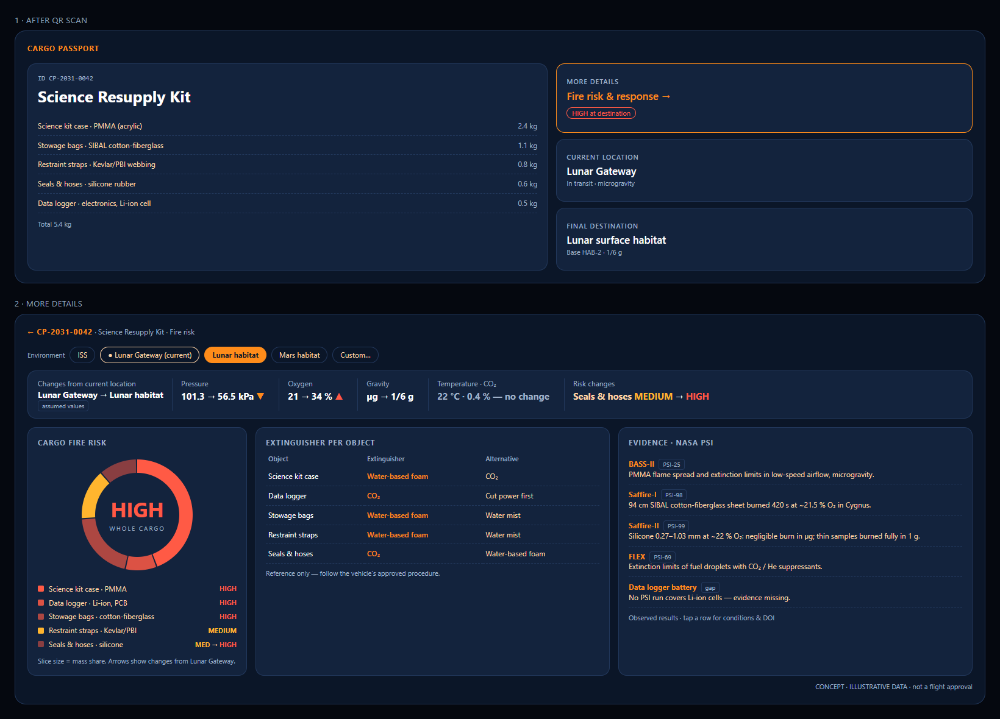

# Cargo Passport: UI/UX description

This document describes the interface a user sees after scanning a cargo QR code. It continues the [cargo passport](cargo-passport.md) concept and the look of the team's pitch video (`brag-output/brag.mp4`), which uses a dark navy background, bright orange highlights, a risk ring and per-item bars.

The sample design is rendered from [`prototype/ui-mock.html`](../prototype/ui-mock.html). It predates two decisions below: the circle diagram shows evidence status instead of HIGH/MEDIUM/LOW, and contents show mass share instead of kg. **The working frontend is [`frontend/index.html`](../frontend/index.html)**, built on the [backend API](../backend/API.md).

## 1. Visual system

The app has a single dark theme.

| Token | Value |
|---|---|
| Background | Dark blue `#0b1628` |
| Card | `#13233d` |
| Card border | `#22385c` |
| Primary text | White `#ffffff` |
| Secondary text | Light orange `#ffd3a6` |
| Muted labels | `#9fb0c8` |
| Accent (links, active chip, IDs, "More details", extinguisher names) | Bright orange `#ff8c1a` |
| Evidence status: found / gap / not assessed / no hazard (attributed) | `#4fb3ff` / `#ff5a45` / `#6b7c96` / `#3ccf8e` |

- **Type:** a sans-serif typeface for text and a monospace face for IDs, PSI accession numbers and readings, as in the video.
- **Shapes:** rounded cards (radius 14 px), thin borders and pill chips.
- **Status colours:** every status colour also carries a text label, which keeps it readable for colour-blind users.
- **Contrast:** text must meet WCAG AA contrast.

## 2. Screen 1: after scanning the QR code

The layout uses two columns. On a phone in portrait orientation, the columns stack, with the left card first.

### Left: cargo card

A large card aligned to the left, containing in this order:

1. **ID number** in a small monospace font: the cargo slug and configuration version, for example `ID portable-science-instrument · v1`.
2. **Cargo name** in a large bold font, for example *Science Resupply Kit*.
3. **Contents list** in a small font: one row per object, showing its name, main material and share of the cargo mass (%). The backend stores mass shares, not kg.

### Right: three stacked boxes

| Box | Content | Behaviour |
|---|---|---|
| **More details** (top, orange border) | "Fire evidence & response →" and a count for the destination, for example "fire evidence for 3 of 5 components in manifest, 1 gap(s)" | The only tappable box; it opens Screen 2. |
| **Current location** | Start of the cargo's route, with the route description | Information only |
| **Final destination** | End of the cargo's route, with its gravity and route ID | Information only |

**Where the data comes from.** The QR code encodes a link such as `frontend/index.html?cargo=<slug>&route=<route id>`. The cargo comes from `GET /cargo/{slug}`. The current location and final destination are the `from_env` and `to_env` of the route in `GET /routes` (default `R23`, ISS → NASA lunar surface base).

## 3. Screen 2: More details

A header shows a back arrow, the cargo ID and the cargo name.

### Environment selector

A row of chips, one per environment from `GET /environments`. The cargo's current location is marked "● (current)". The cargo's destination is selected by default.

**Changes from current location.** Below the chips, a strip compares the cargo's current location with the selected environment:

- One cell per condition: **pressure (kPa), oxygen (%), gravity, temperature (°C) and CO₂ (%)**. Each cell shows `current → selected`, with ▲ or ▼ for the direction of change. Conditions that stay the same are grouped as "no change"; conditions unknown at both places are grouped as "unknown at both".
- A final cell, **Evidence changes**, names every object whose evidence status or match/differs/unknown counts change, for example "Enclosure match/differs/unknown 2/1/1 → 0/1/3". Otherwise it reads "No evidence changes".
- When the user selects the current location itself, the strip reads "This is the cargo's current location" and shows its values.

Other rules:

- Each environment is compared once with `POST /scenarios/compare` and cached while the page is open.
- **Data status:** unknown values stay "unknown"; the strip lists the scenario's `incomplete_dimensions`. Only the ISS has a published cabin atmosphere (see [environment dimensions](environments/environment-dimensions.md)).
- **Custom…** opens sliders for oxygen, pressure, airflow, temperature and CO₂ on top of a chosen base environment (which sets gravity). Values are sent as `overrides` and labelled "your values"; they are the user's scenario, not measurements.
- A **Use state** selector (stowed, operating, charging, maintenance) sits in the header; changing it re-runs the comparison.

### Panel A: Cargo fire evidence (circle diagram)

The backend rules ([API.md §3](../backend/API.md#3-rendering-rules-from-the-build-plan)) forbid scores, verdicts and "safe" labels, so the diagram shows **evidence status**, not HIGH/MEDIUM/LOW.

- **Diagram:** a donut chart in which each object is one segment. Segment size equals its mass share; segment colour equals its fire coverage status: evidence found, gap, not assessed or no hazard (attributed).
- **Centre:** a count with its denominator, for example `3/5 WITH FIRE EVIDENCE`. Never a percentage.
- **Legend:** each object, its material, its status and its exact / related / analogue record counts. A final row shows the **whole assembly**, which stays a gap until assembly-level evidence exists.

### Panel B: Extinguisher for each object

A table with one row per object and three columns: **Object · Extinguisher · Alternative**. The Extinguisher column names the actual agent:

| Object type | Extinguisher | Alternative |
|---|---|---|
| Plastics (for example the PMMA case) | Water-based foam | CO₂ |
| Fabrics and webbing (bags, straps, clothing) | Water-based foam | Water mist |
| Rubber parts (silicone seals and hoses) | CO₂ | Water-based foam |
| Electronics and batteries (data logger) | CO₂ | Cut power first |

Electronics always get CO₂, with "Cut power first" as the instruction in the Alternative column. The table never shows a "water not possible" warning; it names the correct extinguisher instead.

The panel footer reads **"Reference only — follow the vehicle's approved procedure."** The passport links to response references; it does not generate emergency instructions ([cargo passport rules](cargo-passport.md#rules-for-presenting-conclusions)).

### Panel C: Evidence from NASA PSI

For each object, the top-ranked PSI record from the comparison: accession number, evidence class (exact or related), match / differs / unknown counts, the first reasons and a DOI link. Analogue records (the ACME BRE gas burner) are counted separately, verified findings are listed, and the backend's limitations are shown at the bottom. Examples of the kind of records shown:

- **BASS-II** (`PSI-25`): PMMA flame spread and extinction limits in low-speed airflow, microgravity.
- **Saffire-I** (`PSI-98`): a 94 cm SIBAL cotton-fiberglass sheet burned for 420 s at about 21.5% O₂ in a Cygnus vehicle.
- **Saffire-II** (`PSI-99`): silicone samples 0.27–1.03 mm thick showed negligible burning in microgravity, while thin samples burned fully in 1 g.
- **FLEX** (`PSI-69`): extinction limits of fuel droplets with CO₂ and He suppressants.

**Missing evidence is listed as a gap**, for example "Battery pack: no PSI or material record". Gaps are never hidden.

## 4. States and edge cases

- **Unknown QR code:** "Cargo not found. Scan the QR code again."
- **API unreachable:** the error and the API address are shown.
- **No evidence for an object:** shown as *gap* in Panels A and C.
- **Footer on Screen 2:** "<provenance> CARGO · EVIDENCE COMPARISON · not a safety approval".

### Below the panels: Ask about this evidence and Passport

- **Ask about this evidence** (`POST /scenarios/explain`): pick an object, optionally type a question, press **Explain**. Each sentence carries numbered citations that link to the record list underneath (record id, excerpt, locator). The panel shows the four states from [API.md §4](../backend/API.md#4-si-explanation): answer, unavailable, withheld (rejected) and error, and always the AI disclosure. Without a question it is one provider request; a question lets the model use read-only lookups (including comparing another environment), which is slower.
- **Passport**: **Download passport (JSON)** stores and downloads the snapshot (`POST /passports/export`) for the current environment, overrides and use state. **Create share link** saves the cargo and scenario (`POST /shares`), copies a `?share=<slug>` link and keeps the edit token in this browser; the button then becomes **Save changes to link** (`PUT /shares/{slug}`). Opening a share link restores the cargo, environment, overrides and use state.

## 5. Running it

The backend serves this page at `http://localhost:8000/app/` (same origin, so no CORS setup); see [backend/README.md](../backend/README.md#running-for-the-demo-local-neon-main).

## 6. Out of scope for now

The following are not covered yet: the offline banner, a QR scanner design (the device camera opens), user accounts, editing cargo contents, and the flame-spread animation and storage map from the video.
